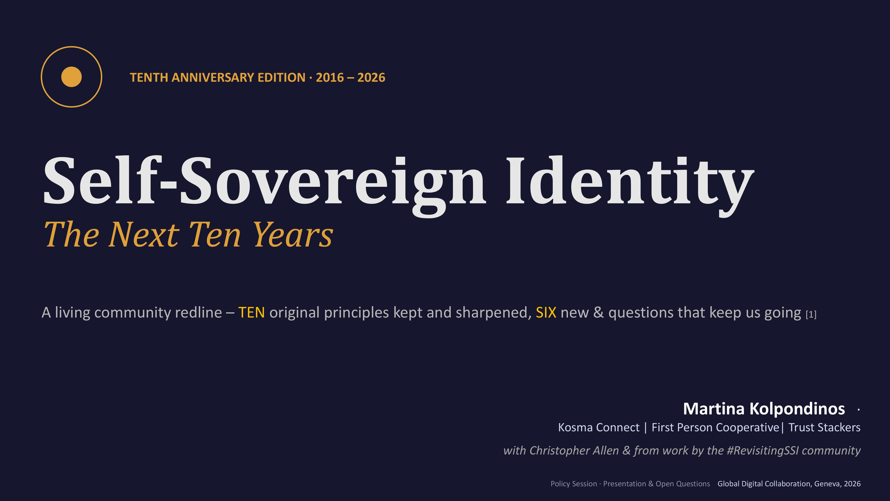

## Most Recent Meeting

<table>
 <tr>
    <td>

      

    </td>
    <td>
       <h2><a href="/meetings/2026-08-gdc/">GDC 26 (September 2026)</a></h2>

       
A presentation on "Self-Sovereign Identity: The Next Ten Years" for GDC 26 in Geneva, Switzerland

       
    </td>
  </tr>
</table>  

_See the [archives](/meetings/archives/) for all past meetings._



## Future Meetings

All-hands meetings are expected to be:

- **Frequency**: Monthly (last week of the month)
- **Format**: Working sessions focused on cross-Circle dialogue, feedback on emerging briefs, and collaborative problem-solving
- **Duration**: 90 minutes

Final dates and Zoom links will be shared through Signal and email channels.

Community meetings will use Zoom with accessibility features available on request. **Transcripts and video recordings** will be provided within a few days after each meeting for those who cannot attend synchronously or need to review discussions.



